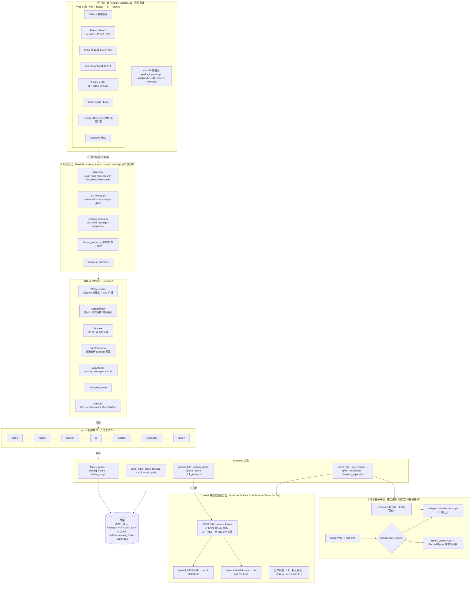
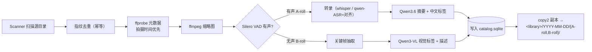

# CutFinder 架构图（Mermaid 源）

图形版：[`architecture.svg`](./architecture.svg) / [`architecture.png`](./architecture.png)。
本文件是可维护的文本源，改动结构时同步更新两者即可。

## 逐条 clip 流水线

## 硬约束

1. 原始素材**只读**：不移动、不改名、不改写，所有归档动作发生在目标库副本上。
2. **拍摄时间永不改变**：读取内嵌 QuickTime/EXIF 时间，副本用 `shutil.copy2` 保留文件系统时间。
3. **完全本地/离线**：画面与音频不出本机，全部推理跑在 Apple Silicon 上。
4. **重扫幂等**：按文件指纹去重，只处理新文件，不重复复制。
